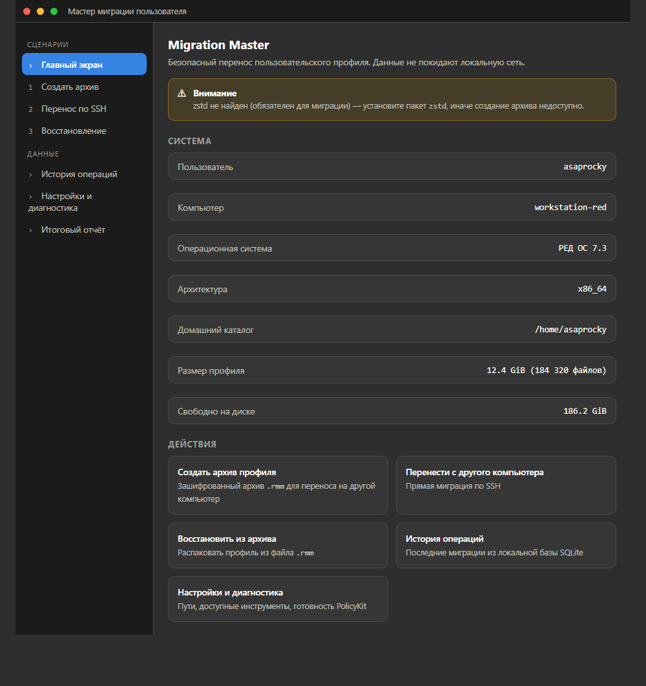
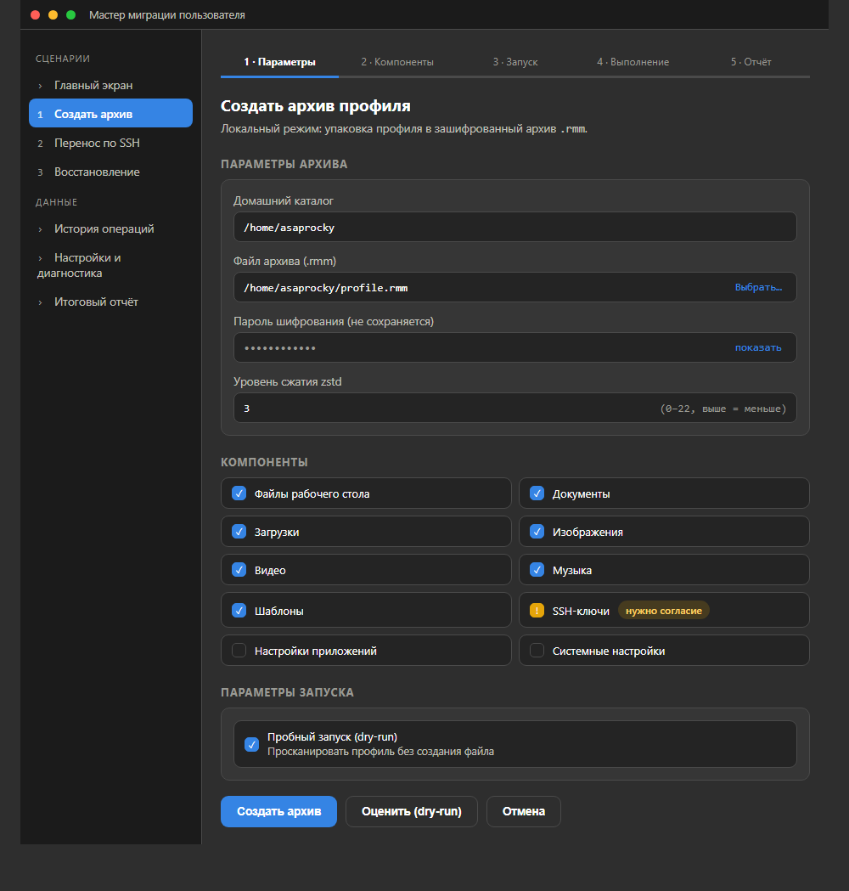
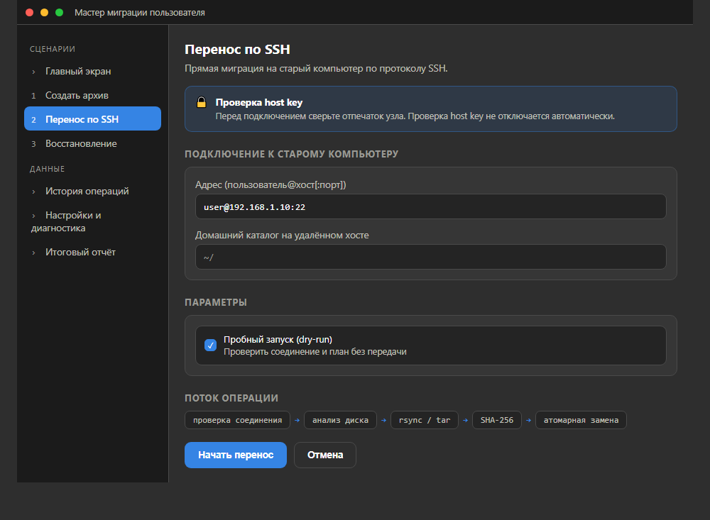
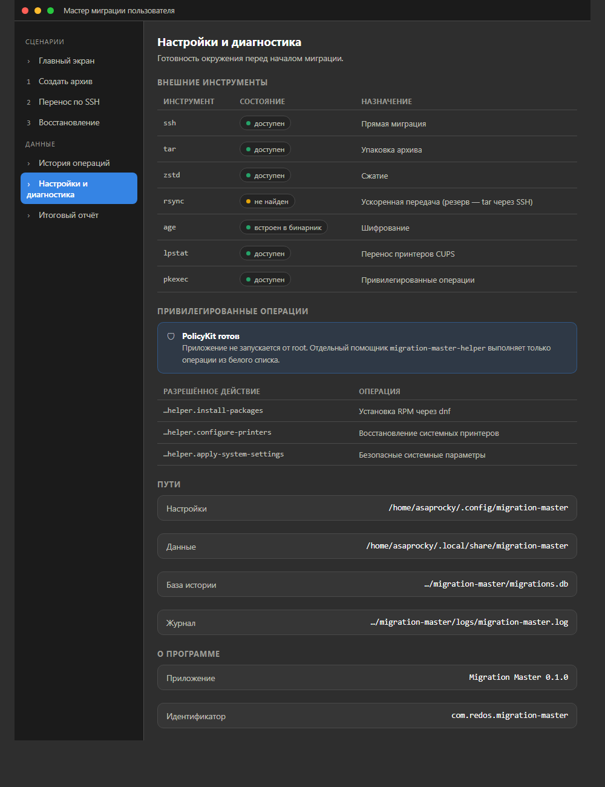
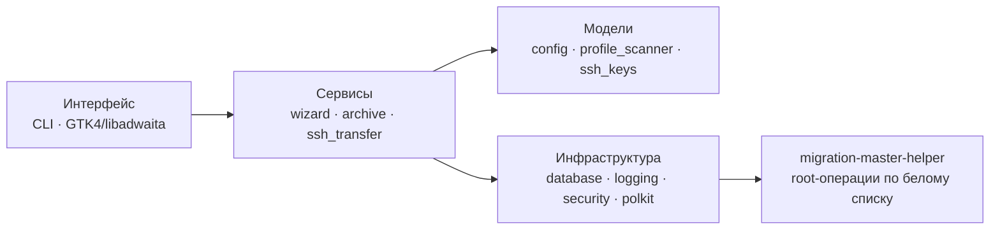

<p align="center">
  
</p>

<h1 align="center">Migration Master</h1>

<p align="center"><b>Мастер миграции пользовательского профиля для РЕД ОС Linux</b></p>

<p align="center">
  <a href="https://github.com/flytimopheev-sketch/MMigration/releases/latest"></a>
  <a href="https://github.com/flytimopheev-sketch/MMigration/actions/workflows/rust.yml"></a>
  <a href="https://github.com/flytimopheev-sketch/MMigration/actions/workflows/release-rpm.yml"></a>
  
  
  
</p>

<p align="center">
  <a href="#возможности">Возможности</a> •
  <a href="#скриншоты">Скриншоты</a> •
  <a href="#быстрый-старт">Быстрый старт</a> •
  <a href="#документация">Документация</a> •
  <a href="#разработка">Разработка</a>
</p>

---

**Migration Master** переносит пользовательский профиль со старого компьютера
или старой установки РЕД ОС на новый: создаёт зашифрованный архив `.rmm`,
переносит профиль напрямую по SSH, восстанавливает данные на целевой машине.

Данные **не покидают локальную сеть**: ни одного обращения к внешним сервисам,
только SSH между вашими компьютерами. Пароли и приватные ключи не сохраняются
в журналах и отчётах.

Приложение работает в двух режимах и использует одни и те же сервисы:

| Режим | Запуск | Для кого |
|---|---|---|
| **Графический мастер** (GTK4 + libadwaita) | `migration-master gui` или ярлык в меню | обычный пользователь |
| **Консольный интерфейс** (CLI) | `migration-master <команда>` | скрипты, удалённая машина, автоматизация |

## Возможности

- 🔐 **Зашифрованные архивы `.rmm`** — zstd-tar с `manifest.json` первой
  записью, шифрование [age](https://age-encryption.org/) по паролю,
  проверка целостности SHA-256
- 🔗 **Прямая миграция по SSH** — `scp` (или `rsync`, если установлен) по SSH,
  проверка host key вручную, отмена по Ctrl+C
- 📦 **Компоненты переноса** — документы, загрузки, фото, видео, музыка,
  шаблоны, настройки и данные приложений (включая Firefox, Thunderbird, Git и
  shell-конфиги), SSH-ключи. Каталоги XDG (`Desktop`, `Documents` и т.п.)
  читаются из `user-dirs.dirs`, а не угадываются по локали
- 🖨 **Принтеры CUPS** — имя, модель, URI и принтер по умолчанию сохраняются в
  manifest; восстановление через `lpadmin`/`cupsenable` выполняется помощником
  `migration-master-helper` по PolicyKit и только при явном флаге/галочке
- 📋 **Пакеты** — в архив попадает список явно установленных пользователем
  пакетов (`dnf repoquery --userinstalled`, fallback `dnf history
  userinstalled`; для dpkg — `apt-mark showmanual`). При восстановлении
  показывается разница с целевой системой, установка — только по явному
  подтверждению через помощник
- ⚙️ **Настройки пользователя** — dconf и crontab сохраняются в manifest;
  dconf/cron применяются от имени пользователя, а системные компоненты — через
  помощник по PolicyKit
- 🛡 **Безопасность** — защита от path traversal, атомарная запись файлов,
  привилегированный помощник с белым списком команд; GUI никогда не запускается
  от root и вызывает `pkexec` только для явно подтверждённых операций
- 🗂 **История и отчёты** — журнал операций в SQLite, отчёты в JSON/HTML/TXT
- 🖥 **Графический мастер** — GTK4 + libadwaita: главный экран, создание
  архива, перенос по SSH, восстановление, история и диагностика

## Скриншоты

> Это макет интерфейса ([живой макет](migration-master/docs/ui-mockup.html) —
> открывается в браузере). Реализация — в `migration-master/src/ui/gtk_app.rs`.

<table>
<tr>
<td width="50%"></td>
<td width="50%"></td>
</tr>
<tr>
<td></td>
<td></td>
</tr>
</table>

## Быстрый старт

### РЕД ОС 8 (x86_64)

```bash
sudo dnf install ./migration-master-0.2.0-1.x86_64.rpm
migration-master gui        # графический мастер
```

Готовые RPM публикуются в [Releases](https://github.com/flytimopheev-sketch/MMigration/releases).
Пакет содержит и CLI, и графический мастер; GUI использует GTK4 ≥ 4.0 и
libadwaita ≥ 1.0, поэтому работает на РЕД ОС 8.

### Из исходников

```bash
sudo dnf install rust cargo gcc make pkgconf-pkg-config \
                 gtk4-devel libadwaita-devel sqlite-devel openssh-clients

cd migration-master
cargo build --release --features gui   # CLI + GUI
cargo test  --release                  # юнит-тесты
./target/release/migration-master gui
```

### Консольный режим

```bash
migration-master scan --quick                 # что есть в профиле и каких утилит не хватает
migration-master create --output profile.rmm --ask-passphrase
migration-master verify profile.rmm --ask-passphrase
migration-master restore profile.rmm --target /home/user --strategy rename
migration-master migrate-ssh user@192.168.1.10 --dry-run
migration-master report --format html
```

Полный список команд — `migration-master --help` или
[руководство пользователя](migration-master/docs/USER_GUIDE_RU.md).

## Как это устроено



Пять уровней, зависимости строго сверху вниз: `UI → сервисы → модели →
инфраструктура → привилегированный помощник`. Подробности — в
[ARCHITECTURE.md](migration-master/docs/ARCHITECTURE.md).

Формат архива `.rmm`:

```
profile.rmm
└── zstd-tar (при наличии пароля целиком зашифрован age)
    ├── manifest.json   # метаданные: компоненты, файлы, размеры, SHA-256
    └── файлы профиля с относительными путями
```

Отдельных `data.zst` и `checksum.sha256` внутри формата нет: сжатие и
шифрование применяются ко всему tar-потоку, а хеши хранятся в манифесте.

## Требования

| Компонент | Версия | Назначение |
|---|---|---|
| РЕД ОС Linux | 8.x (x86_64) | целевая платформа |
| Rust | 1.75+ | сборка из исходников |
| GTK4 | ≥ 4.0 | графический мастер |
| libadwaita | ≥ 1.0 | графический мастер |
| OpenSSH (`ssh`, `scp`) | — | прямая миграция по SSH |
| `rsync` | — | необязательно: быстрее SSH-передача |
| CUPS (`lpstat`) | — | необязательно: список принтеров |
| `pkexec` + polkit | — | установка пакетов и настройка принтеров через помощник |
| `tar`, `zstd`, `gpg` | — | необязательно: ручные дополнительные архивы |

Сами `.rmm` создаются Rust-библиотеками (`tar`, `zstd`, `age`), внешние
`tar`/`zstd` для работы программы не нужны. Подробный список — в
[INSTALL.md](migration-master/docs/INSTALL.md).

## Документация

| Документ | Содержание |
|---|---|
| [Установка](migration-master/docs/INSTALL.md) | RPM и сборка из исходников, внешние утилиты |
| [Руководство пользователя](migration-master/docs/USER_GUIDE_RU.md) | оба режима миграции, компоненты, конфликты |
| [Образ хоста без root](migration-master/docs/HOST_IMAGE.md) | снимок профиля, ручные дополнения, полный образ диска |
| [План улучшений](migration-master/docs/IMPROVEMENTS.md) | что вошло в 0.2.0 и что осталось на будущее |
| [Сборка RPM](migration-master/docs/BUILD_RPM.md) | `rpmbuild`, `%check`, варианты сборки, проверка пакета |
| [Устранение неполадок](migration-master/docs/TROUBLESHOOTING.md) | типовые ошибки, диагностика GUI и CLI |
| [Безопасность](migration-master/docs/SECURITY.md) | модель угроз, шифрование, path traversal, polkit |
| [Резервное копирование](migration-master/docs/BACKUP.md) | создание, проверка и откат копий |
| [Восстановление после ошибки](migration-master/docs/RECOVERY.md) | откат и разбор сбоев |
| [Архитектура](migration-master/docs/ARCHITECTURE.md) | слои, потоки данных, формат архива |
| [Участие в разработке](migration-master/docs/CONTRIBUTING.md) | структура проекта, чек-лист, тесты |
| Man-страница | `man migration-master` |

## Разработка

```bash
cd migration-master
cargo fmt --all -- --check
cargo clippy --all-targets --all-features -- -D warnings
cargo test --all-features
```

Сборка RPM и публикация релиза описаны в
[BUILD_RPM.md](migration-master/docs/BUILD_RPM.md); правила оформления
изменений — в [CONTRIBUTING.md](CONTRIBUTING.md).

## Статус проекта

Готово и покрыто тестами: ядро архивов (создание/просмотр/проверка/восстановление),
шифрование age, защита от path traversal, атомарная запись, режим `dry-run`,
перенос по SSH (scp/rsync с `--partial`), группы файловых компонентов,
метаданные приложений, пакетов, принтеров, dconf и cron, история в SQLite,
отчёты, графический мастер с предпросмотром, отменой и резервным копированием.

В 0.2.0 закрыты P0/P1 из плана улучшений: интерактивный `ask` в CLI (в GUI
безопасный `rename`), явные флаги приватных SSH-ключей и `authorized_keys`,
применение dconf/cron, установка пакетов и настройка принтеров через помощник,
единый скан для `scan` и `create`, автоматический backup в CLI. Остались
необязательные улучшения: полноценный диалог конфликтов в GUI, ACL/xattr/
SELinux в архиве и расширенные e2e-тесты — см.
[IMPROVEMENTS.md](migration-master/docs/IMPROVEMENTS.md).

## Лицензия

[GPL-3.0](LICENSE) © Migration Master Team.
