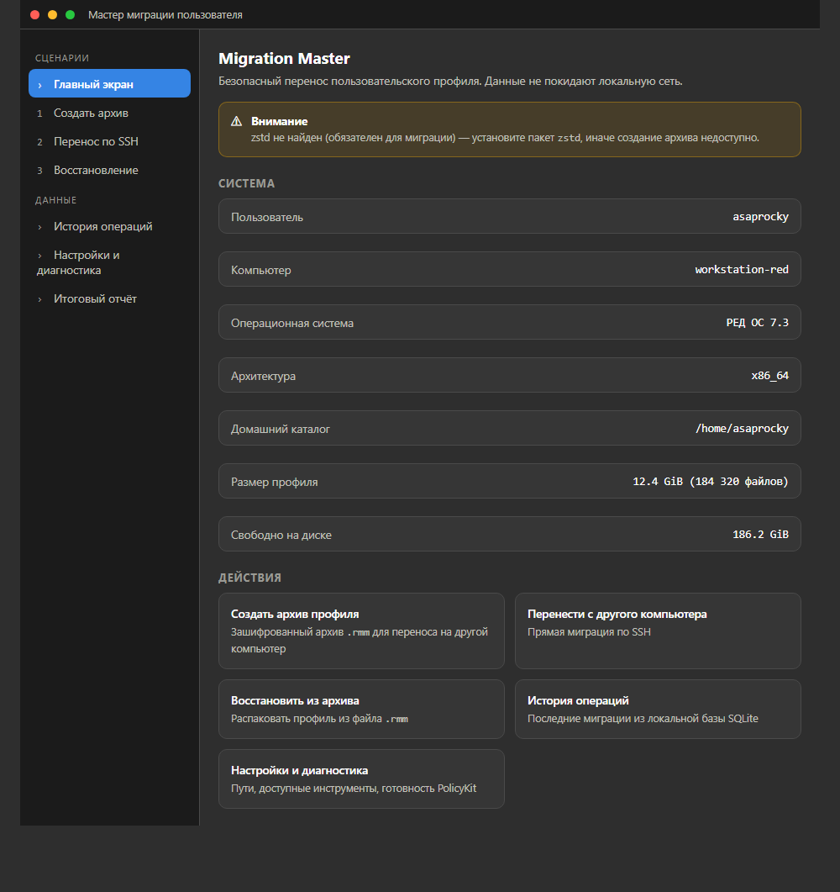
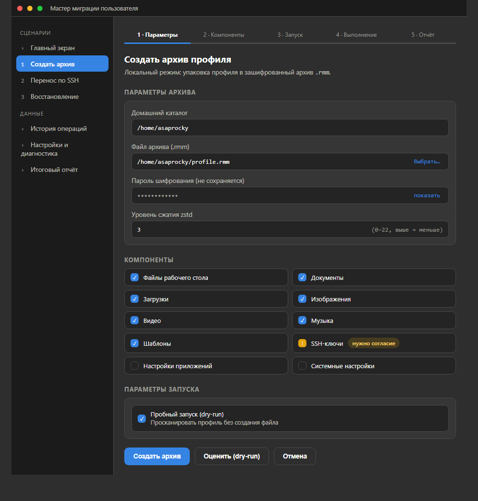
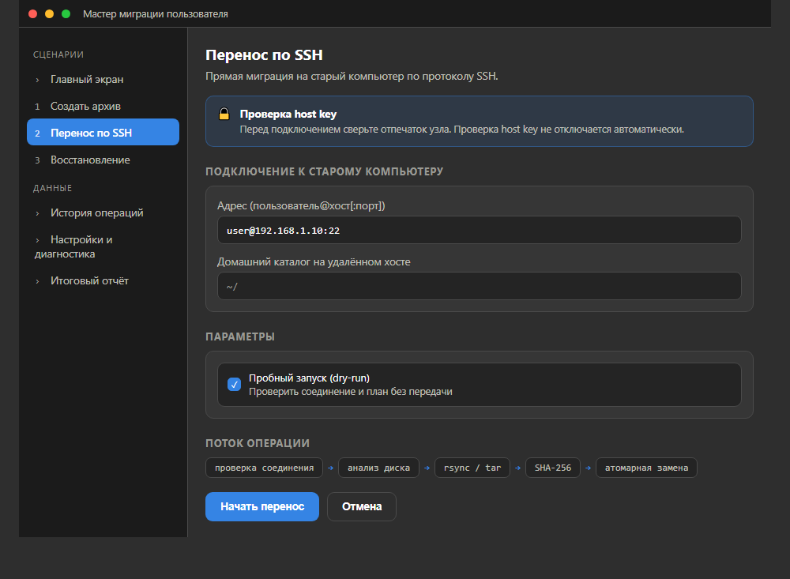
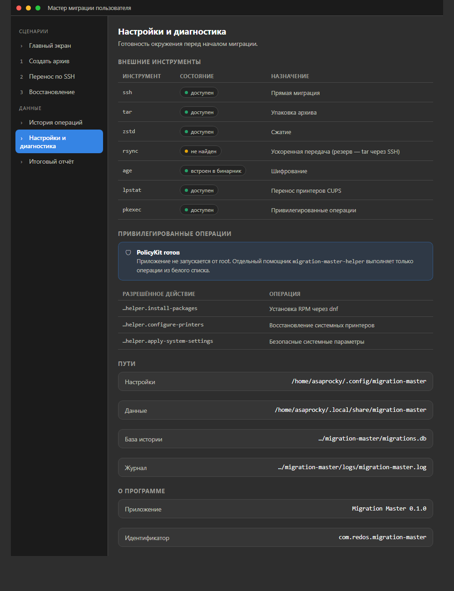
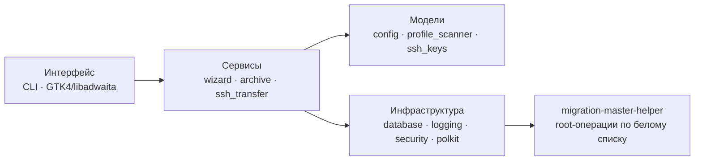

<p align="center">
  
</p>

<h1 align="center">Migration Master</h1>

<p align="center"><b>Мастер миграции пользовательского профиля для РЕД ОС Linux</b></p>

<p align="center">
  <a href="https://github.com/flytimopheev-sketch/MMigration/releases/latest"></a>
  <a href="https://github.com/flytimopheev-sketch/MMigration/actions/workflows/rust.yml"></a>
  <a href="https://github.com/flytimopheev-sketch/MMigration/actions/workflows/release-rpm.yml"></a>
  
  
  
</p>

<p align="center">
  <a href="#возможности">Возможности</a> •
  <a href="#скриншоты">Скриншоты</a> •
  <a href="#быстрый-старт">Быстрый старт</a> •
  <a href="#документация">Документация</a> •
  <a href="#разработка">Разработка</a>
</p>

---

**Migration Master** переносит пользовательский профиль со старого компьютера
или старой установки РЕД ОС на новый: создаёт зашифрованный архив `.rmm`,
переносит профиль напрямую по SSH, восстанавливает данные на целевой машине.

Данные **не покидают локальную сеть**: ни одного обращения к внешним сервисам,
только SSH между вашими компьютерами. Пароли и приватные ключи не сохраняются
в журналах и отчётах.

Приложение работает в двух режимах и использует одни и те же сервисы:

| Режим | Запуск | Для кого |
|---|---|---|
| **Графический мастер** (GTK4 + libadwaita) | `migration-master gui` или ярлык в меню | обычный пользователь |
| **Консольный интерфейс** (CLI) | `migration-master <команда>` | скрипты, удалённая машина, автоматизация |

## Возможности

- 🔐 **Зашифрованные архивы `.rmm`** — формат `manifest.json` + `data.zst` +
  `checksum.sha256`, шифрование [age](https://age-encryption.org/) по паролю,
  проверка целостности SHA-256
- 🔗 **Прямая миграция по SSH** — `rsync`/`tar` по SSH, проверка host key,
  возобновление и отмена (Ctrl+C)
- 📦 **Компоненты переноса** — документы, загрузки, фото, видео, музыка, шаблоны
  рабочего стола, настройки приложений, SSH-ключи, системные настройки
- 🖨 **Перенос принтеров** — интеграция с CUPS, полные URI (`ipp://`, `lpd://`, `smb://`)
- 📋 **Экспорт списка пакетов** — список установленных RPM переносится как
  перечень (файлы пакетов не копируются), на целевой машине пакеты ставятся
  из репозиториев
- 🛡 **Безопасность** — защита от path traversal, атомарная запись файлов,
  белый список привилегированных операций через PolicyKit
- 🗂 **История и отчёты** — журнал операций в SQLite, отчёты в JSON/HTML/TXT
- 🖥 **Графический мастер** — GTK4 + libadwaita: главный экран, создание
  архива, перенос по SSH, восстановление, история и диагностика

## Скриншоты

> Это макет интерфейса ([живой макет](migration-master/docs/ui-mockup.html) —
> открывается в браузере). Реализация — в `migration-master/src/ui/gtk_app.rs`.

<table>
<tr>
<td width="50%"></td>
<td width="50%"></td>
</tr>
<tr>
<td></td>
<td></td>
</tr>
</table>

## Быстрый старт

### РЕД ОС 8 (x86_64)

```bash
sudo dnf install ./migration-master-0.1.4-1.x86_64.rpm
migration-master gui        # графический мастер
```

Готовые RPM публикуются в [Releases](https://github.com/flytimopheev-sketch/MMigration/releases).
Пакет содержит и CLI, и графический мастер; GUI использует GTK4 ≥ 4.0 и
libadwaita ≥ 1.0, поэтому работает на РЕД ОС 8.

### Из исходников

```bash
sudo dnf install rust cargo gcc make pkgconf-pkg-config \
                 gtk4-devel libadwaita-devel sqlite-devel cups-devel openssh-clients

cd migration-master
cargo build --release --features gui   # CLI + GUI
cargo test  --release                  # юнит-тесты
./target/release/migration-master gui
```

### Консольный режим

```bash
migration-master scan --quick                 # что есть в профиле и каких утилит не хватает
migration-master create --output profile.rmm --passphrase
migration-master verify profile.rmm --passphrase '...'
migration-master restore profile.rmm --target /home/user --strategy replace
migration-master migrate-ssh user@192.168.1.10 --dry-run
migration-master report --format html
```

Полный список команд — `migration-master --help` или
[руководство пользователя](migration-master/docs/USER_GUIDE_RU.md).

## Как это устроено



Пять уровней, зависимости строго сверху вниз: `UI → сервисы → модели →
инфраструктура → привилегированный помощник`. Подробности — в
[ARCHITECTURE.md](migration-master/docs/ARCHITECTURE.md).

Формат архива `.rmm`:

```
profile.rmm
├── manifest.json      # метаданные: компоненты, файлы, размеры
├── data.zst           # сжатые данные (опционально зашифрованные age)
└── checksum.sha256    # контрольная сумма для проверки целостности
```

## Требования

| Компонент | Версия | Назначение |
|---|---|---|
| РЕД ОС Linux | 8.x (x86_64) | целевая платформа |
| Rust | 1.75+ | сборка из исходников |
| GTK4 | ≥ 4.0 | графический мастер |
| libadwaita | ≥ 1.0 | графический мастер |
| OpenSSH (`ssh`) | — | прямая миграция по SSH |
| `tar`, `zstd` | — | упаковка и сжатие архивов |
| CUPS (`lpstat`) | — | перенос принтеров |
| `pkexec` + polkit | — | привилегированные операции |

Подробный список внешних инструментов — в
[INSTALL.md](migration-master/docs/INSTALL.md).

## Документация

| Документ | Содержание |
|---|---|
| [Установка](migration-master/docs/INSTALL.md) | RPM и сборка из исходников, внешние утилиты |
| [Руководство пользователя](migration-master/docs/USER_GUIDE_RU.md) | оба режима миграции, компоненты, конфликты |
| [Сборка RPM](migration-master/docs/BUILD_RPM.md) | `rpmbuild`, `%check`, варианты сборки, проверка пакета |
| [Устранение неполадок](migration-master/docs/TROUBLESHOOTING.md) | типовые ошибки, диагностика GUI и CLI |
| [Безопасность](migration-master/docs/SECURITY.md) | модель угроз, шифрование, path traversal, polkit |
| [Резервное копирование](migration-master/docs/BACKUP.md) | создание, проверка и откат копий |
| [Восстановление после ошибки](migration-master/docs/RECOVERY.md) | откат и разбор сбоев |
| [Архитектура](migration-master/docs/ARCHITECTURE.md) | слои, потоки данных, формат архива |
| [Участие в разработке](migration-master/docs/CONTRIBUTING.md) | структура проекта, чек-лист, тесты |
| Man-страница | `man migration-master` |

## Разработка

```bash
cd migration-master
cargo fmt --all -- --check
cargo clippy --all-targets --all-features -- -D warnings
cargo test --all-features
```

Сборка RPM и публикация релиза описаны в
[BUILD_RPM.md](migration-master/docs/BUILD_RPM.md); правила оформления
изменений — в [CONTRIBUTING.md](CONTRIBUTING.md).

## Статус проекта

Готово и покрыто тестами: ядро архивов (создание/просмотр/проверка/восстановление),
шифрование age, защита от path traversal, атомарная запись, режим `dry-run`,
перенос по SSH, разрешение конфликтов, отмена операций, история в SQLite,
отчёты, графический мастер.

Развивается: пошаговый мастер с предварительным просмотром плана, интерактивное
разрешение конфликтов, расширенные правила переноса приложений.

## Лицензия

[GPL-3.0](LICENSE) © Migration Master Team.
